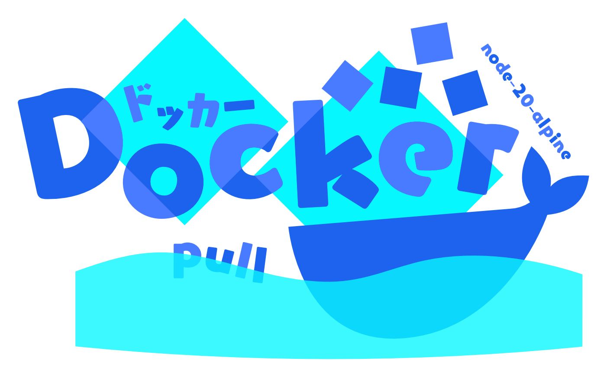

  
  

    
    <strong>I'm currently focused on Agent.</strong>
  

  

    <code>🐼 Born 2003.02</code>
    <code>📍 Now Base in ChangChun.</code>
  

## ABOUT ME
### 🏫 ChangChun University of  Technology | Artificial Intelligence | Class Of 2026

<!-- 右侧像素小人 -->

### 🌱 Internship Experience
- `Secret`

### 🛠️ Open Source Contributions

- `Please see my GitHub contributions`

### 🤖 Competition Experience
- `ICPC` : `Silver Award · ChangChun`
- `Mathematical Modeling` : `Gold Award`
- `LanQiao Cup` : `National Bronze Award`

<!-- 三个工具图标，放在徽章下方 -->
<!-- 三个工具图标：每个 img 单独 align="right"，触发浮动，文字环绕 -->
<!-- 顺序反过来写：Docker 最右，IntelliJ 中间，VSCode 最左 -->

### 💻 Connect With Me
- 📺 BiliBili : `喵喵种子芽`
- 📫 E-mail : `1102042053@qq.com`

  

<!-- 外层 div：控制整体的上下间距 -->

  
  <!-- 第一个链接：邮箱跳转 -->
  <a href="mailto:1102042053@qq.com">  
    <!-- 链接里的图片：邮箱徽章 -->
      
  </a>  
  <!-- 第二个链接：力扣跳转 -->
  <a href="https://leetcode.cn/u/mai-liao-ba-tai/">  
    <!-- 链接里的图片：力扣徽章 -->
      
  </a>  

  <picture>
    <!-- 深色主题显示深色版贪吃蛇 -->
    <source media="(prefers-color-scheme: dark)" srcset="https://raw.githubusercontent.com/Tongyu233n/Tongyu233n/output/github-contribution-grid-snake-dark.svg">
    <!-- 浅色主题显示浅色版贪吃蛇 -->
    <source media="(prefers-color-scheme: light)" srcset="https://raw.githubusercontent.com/Tongyu233n/Tongyu233n/output/github-contribution-grid-snake.svg">
    <!-- 兜底显示浅色版 -->
    
  </picture>

